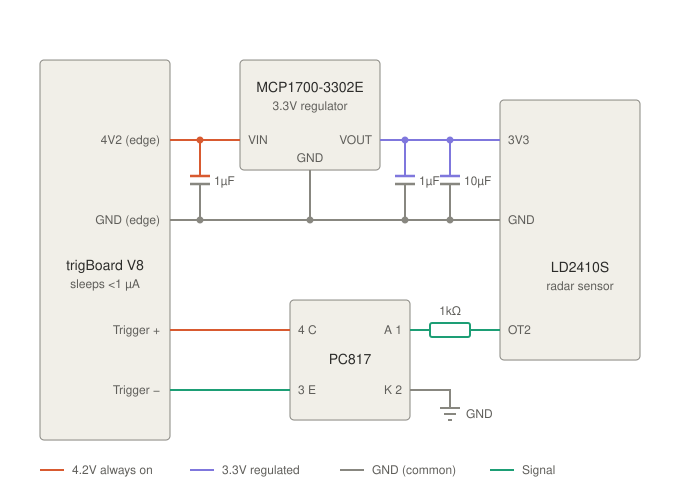

# trigBoard V8 firmware (Excel Psychology build)

Kevin Darrah's trigBoard V8 base firmware, with local changes that POST events to our
webhook server (`webhook.ino`). The firmware version string is `excel-1.0`
(`trigBoardV8_BaseFirmware.ino`).

Upstream documentation: https://trigboard-docs.readthedocs.io/en/latest/index.html

## Check that it's a V8 board

This firmware is for the **V8 (ESP32)** only. The older **V7 (ESP8266)** board uses different
firmware (`../trigBoardHttpPost`) and can't run this.

| | V8 (this firmware) | V7 |
|---|---|---|
| Module | ESP32 (metal can marked ESP32-WROOM) | ESP8266 (ESP-12) |
| Bluetooth | Yes: appears in the configurator as `trigBoard` | None |
| Setup | Bluetooth configurator | Creates a `trigBoard` WiFi network for setup |

If the configurator can connect to it, it's a V8. The configurator also shows the
firmware version: `excel-1.0` means it is already running this build.

## Getting started

```bash
make install   # PlatformIO (via Homebrew) plus the pinned toolchain and libraries
make build     # compile
```

## Configure the board (Bluetooth)

1. Open the configurator in **Chrome** (Safari doesn't support Web Bluetooth):
   https://krdarrah.github.io/trigBoardConfigurator/
2. **Hold the wake button for more than 3 seconds**, until the LED flashes quickly and then
   blinks steadily. A short press just fires a trigger and powers off.
3. Click Connect and pick `trigBoard`. Don't pair it from macOS Bluetooth settings;
   it won't appear there.
4. Set WiFi, the board name, and so on. Each setting is saved on the board as you change it.

Settings are stored in `/config.txt` on the board and survive firmware updates.

## Deploy firmware (over WiFi)

1. Connect with the configurator and confirm the status shows **WiFi Connected**. Note the
   IP address shown.
2. Press **OTA start** in the configurator. Bluetooth disconnects and the board waits for
   an upload.
3. Run:
   ```bash
   make deploy IP=<board-ip>
   ```
   The LED toggles while uploading, and the board reboots into the new firmware when done.
   If the upload fails, the board powers off and keeps its old firmware.
4. Reconnect with the configurator and check the firmware version.

To mark a new build, bump `fwVersion` in `trigBoardV8_BaseFirmware.ino`.

## Presence sensor (LD2410S)

An HLK-LD2410S low-power radar sensor wakes the board via the trigger input, acting
like a door contact.



**Parts**

- HLK-LD2410S (3.0–3.6V, about 45–446 µA average depending on refresh rate)
- MCP1700-3302E 3.3V regulator
- 1 µF ceramic capacitor on VIN, 1 µF ceramic plus 10 µF on VOUT, close to the regulator pins
- PC817 optocoupler and a 1 kΩ resistor
- Polarised 2-pin connector (e.g. JST) on the 4V2/GND edge pins, so the regulator can't be
  connected backwards

**Notes**

- Power comes from the **4V2** edge pin, which stays on while the board sleeps. The 3V3 pin
  is switched off during sleep, so don't use it.
- MCP1700 TO-92 pinout, flat face toward you and legs down: **GND, VIN, VOUT**.
- LD2410S header pins: **3V3, GND, OT1 (UART TX), RX, OT2**. OT2 is the presence output:
  high (3.3V) when someone is present.
- OT2 only reaches 3.3V, too close to the trigger's ~3V threshold to drive it directly, so the
  PC817 switches trigger − to the full 4.2V like a contact closure. PC817 pins: 1 anode
  (dot), 2 cathode, 3 emitter, 4 collector. The collector must go to trigger +.
- No bleed resistor is needed: the 4-pin PC817 has no base pin, and the trigBoard input already
  has its own pull-down.
- To check, measure trigger − to GND: about 4.2V with someone present, about 0V without. Below
  about 3.5V, lower the 1 kΩ to 680 Ω.
- Someone arriving sends **Closed** and the room clearing sends **Opened** (after the sensor's
  no-presence delay, set with Hi-Link's tool). Set the trigger to Closes only in the
  configurator to report arrivals only.

## Build details

`platformio.ini` pins the toolchain the stock firmware was released with. Don't change
these casually:

- **Arduino ESP32 core 1.0.4** (`espressif32@1.12.4`)
- **Partitions `min_spiffs.csv`**, which matches the factory layout. A different partition
  scheme won't fit the board's existing app slots and moves the settings storage.
- **ArduinoJson 6.17.2, PubSubClient 2.8**
- **Pushsafer** is copied into `lib/Pushsafer` with the author's SSL patch
  (see `lib/Pushsafer/PATCHED.md`).

The old Arduino IDE binaries (`*.bin`, `factoryProg/`) are from 2020 and are kept for
reference.

## Upstream release notes

3/19/20 - First Release

6/04/20
All trigBoards after this date will be burned with this code
- Fixed a minor bug in the RTC init tab
- Fixed an issue where the battery threshold wasn't saving
- Changed the code directory a little bit for OTA/USB programming of the bin files
- Pretty big change was to use an event handler to detect when the WiFi connection is established - both on WiFi and UDP tabs

6/05/20
- Under development

6/22/20
- Minor performance improvements

8/05/20
- added battery offset to battery voltage measurement

10/10/20
- small change to allow the password to be entered in blank in the configurator in case of connecting to an unsecured network
